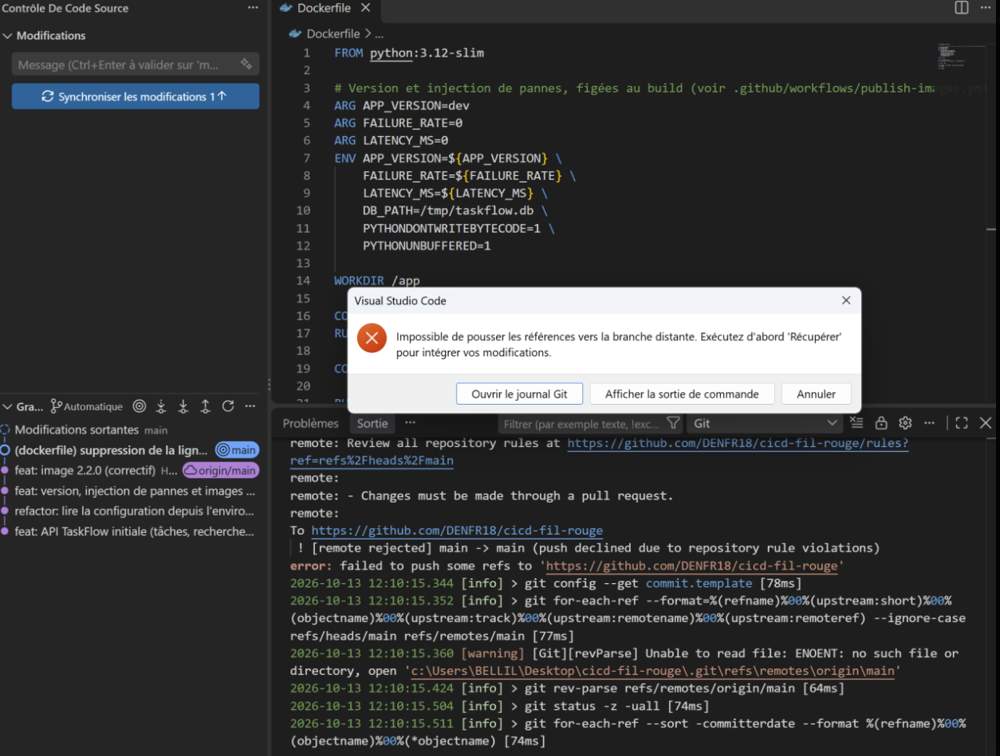
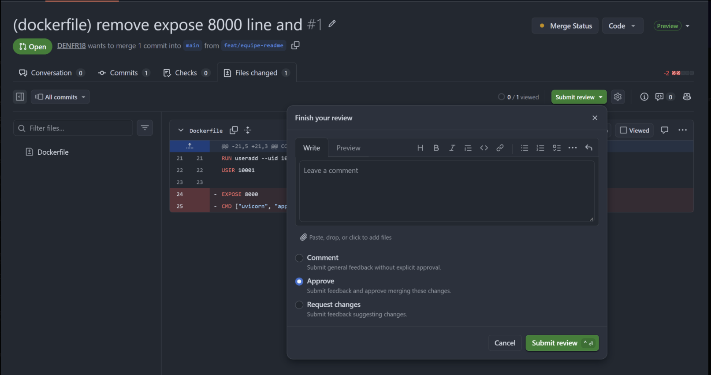
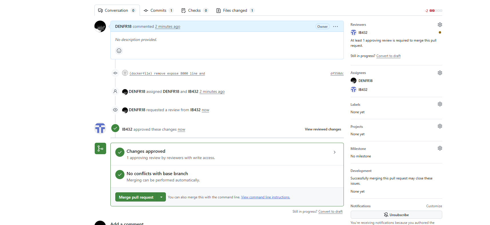
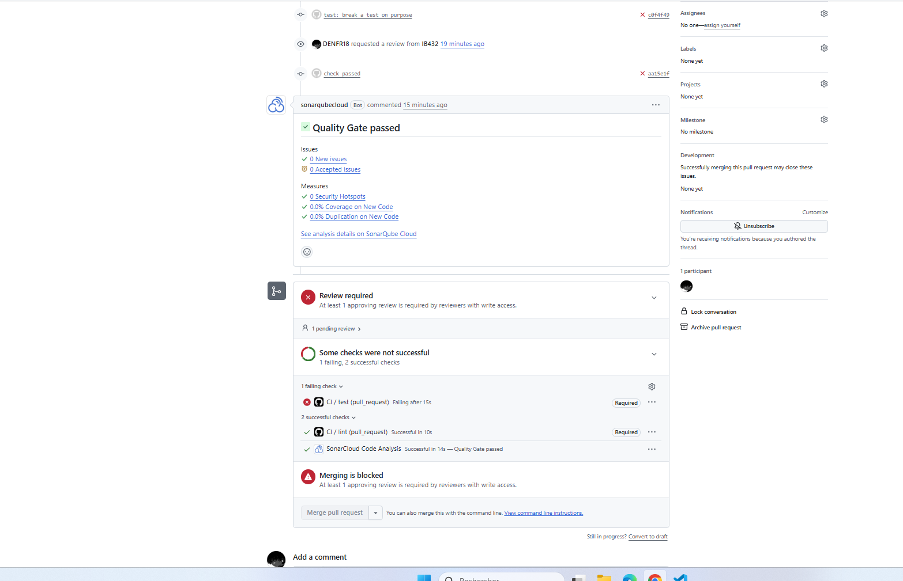
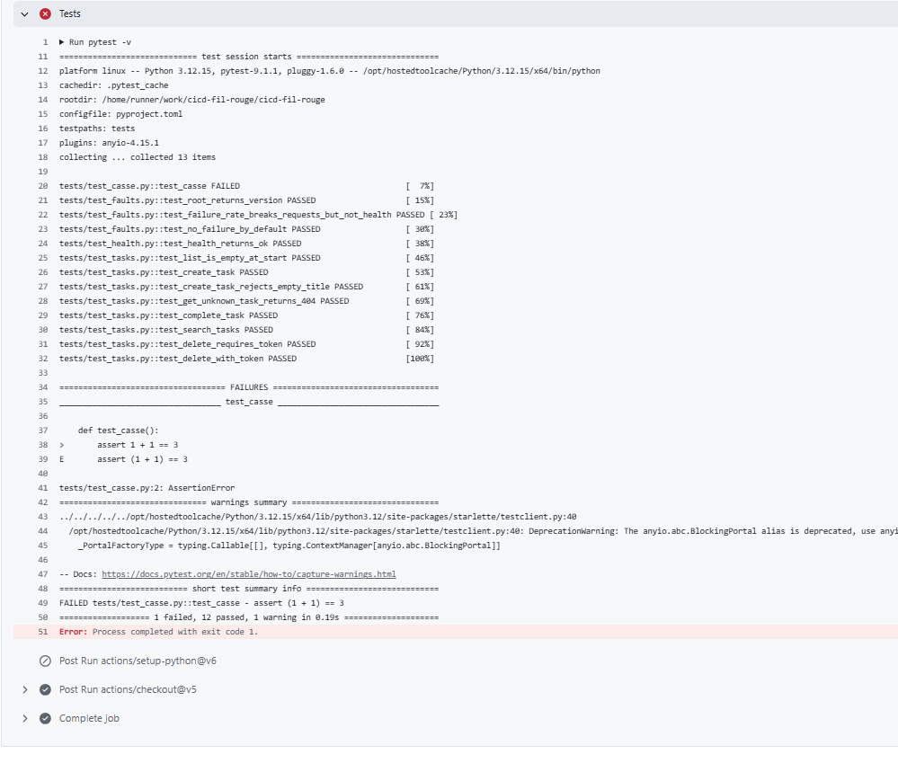

# cicd-fil-rouge — TaskFlow API

API de gestion de tâches développée avec **FastAPI**, support du fil rouge CI/CD.

Fonctionnalités : création, complétion et recherche de tâches, suppression protégée par token, endpoint de santé, et injection de pannes configurable pour les exercices de fiabilité.

Ce dépôt est un fork public de [`9m7fjfpv9k-cyber/cicd-fil-rouge`](https://github.com/9m7fjfpv9k-cyber/cicd-fil-rouge).

## Équipe

| Membre | Compte GitHub | Rôle |
|---|---|---|
| Denilsson | [@DENFR18](https://github.com/DENFR18) | Propriétaire du fork, code owner |
| Illies | [@IB432](https://github.com/IB432) | Collaborateur (write), code owner |

## Structure du projet

```
.
├── .github/
│   ├── CODEOWNERS
│   └── workflows/
│       ├── ci.yml                # Lint + tests sur chaque PR
│       └── publish-images.yml    # Publication des images TaskFlow
├── app/                          # Code de l'API FastAPI
├── tests/                        # Tests pytest (conftest.py + suites)
├── Dockerfile
├── pyproject.toml
└── README.md
```

## Configuration

L'application se configure par variables d'environnement. Les trois premières sont figées au build de l'image via `ARG`.

| Variable | Défaut | Description |
|---|---|---|
| `APP_VERSION` | `dev` | Version exposée par l'API |
| `FAILURE_RATE` | `0` | Taux de requêtes en échec simulé (injection de pannes) |
| `LATENCY_MS` | `0` | Latence ajoutée à chaque requête, en millisecondes |
| `DB_PATH` | `/tmp/taskflow.db` | Chemin de la base SQLite |

## Lancer le projet

### En local

```bash
python -m pip install -e .
python -m pip install pytest httpx ruff
# À VÉRIFIER : adapter le module selon le CMD du Dockerfile
python -m uvicorn app.main:app --reload --port 8000
```

### Avec Docker

```bash
docker build -t taskflow:dev .
docker run --rm -p 8000:8000 taskflow:dev
```

Avec injection de pannes :

```bash
docker build -t taskflow:faulty --build-arg FAILURE_RATE=0.2 --build-arg LATENCY_MS=300 .
```

## Protection de la branche `main`

### Ruleset `protect-main`

| Règle | Effet |
|---|---|
| Pull request obligatoire | Aucun push direct sur `main` |
| 1 approbation requise | Une PR doit être approuvée par un collaborateur avec droits d'écriture |
| Review des code owners | Toute modification de `.github/workflows/` doit être approuvée par un code owner (voir [`.github/CODEOWNERS`](.github/CODEOWNERS)) |
| Status checks requis | Les jobs `lint` et `test` doivent être verts |
| Block force pushes | Réécriture de l'historique interdite |
| Restrict deletions | Suppression de `main` interdite |

### Workflow de contribution

1. Créer une branche depuis `main` à jour (`feat/...`, `fix/...`, `docs/...`).
2. Pousser la branche et ouvrir une PR **vers `main` du fork** (attention au « base repository »).
3. Attendre que `lint` et `test` soient verts.
4. Faire approuver par le binôme.
5. Merger.

### Démonstration

**Push direct refusé.** Une tentative de `git push` sur `main` est rejetée par GitHub :

```
remote: - Changes must be made through a pull request.
 ! [remote rejected] main -> main (push declined due to repository rule violations)
```



**Merge bloqué sans approbation.** La PR #1 affiche « Review required » et le bouton Merge est grisé tant que le binôme n'a pas approuvé :



**Merge autorisé après approbation.** Une fois la PR approuvée par IB432, le merge devient possible :



## Pipeline CI

Le workflow [`.github/workflows/ci.yml`](.github/workflows/ci.yml) garantit qu'**aucun code n'arrive sur `main` sans lint ni tests**.

### Déclenchement

| Événement | Branche | Objectif |
|---|---|---|
| `pull_request` | vers `main` | Valider le code avant le merge |
| `push` | `main` | Revalider `main` après chaque merge |

Le workflow tourne sur `ubuntu-latest` avec Python 3.12, et ses permissions sont limitées à `contents: read`.

### Jobs

Les deux jobs n'ont aucune dépendance entre eux, ils s'exécutent donc **en parallèle**.

| Job | Outil | Commande | Ce qu'il vérifie |
|---|---|---|---|
| `lint` | [ruff](https://docs.astral.sh/ruff/) | `ruff check .` | Analyse statique de tout le code Python : erreurs de syntaxe, imports inutilisés, variables non définies et règles de style (par exemple W292, retour à la ligne manquant en fin de fichier). Le job échoue dès qu'une règle est violée. |
| `test` | [pytest](https://docs.pytest.org/) | `pytest -v` | Exécution de la suite de tests de l'API TaskFlow (13 tests dans `tests/` : santé, CRUD des tâches, recherche, token requis pour la suppression, injection de pannes). La configuration est lue dans `pyproject.toml`. Le job échoue si un seul test échoue. |

Le job `test` installe `pytest`, `httpx` et les dépendances du projet. `httpx` est nécessaire au `TestClient` de FastAPI utilisé dans `tests/conftest.py`.

### Démonstration : merge bloqué par un test en échec

La branche `fix/casse-test` ajoute volontairement un test faux :

```python
def test_casse():
    assert 1 + 1 == 3
```

Résultat sur la PR #3 :

- `lint` ✅ : le code respecte les règles ruff.
- `test` ❌ : `1 failed, 12 passed` (`AssertionError` sur `test_casse`).
- Le bouton **Merge pull request** est grisé : le check requis `test` est en échec.





La PR a été fermée sans être mergée.

### Lancer les vérifications en local

```bash
python -m pip install ruff pytest httpx
python -m ruff check .
python -m pytest -v
```