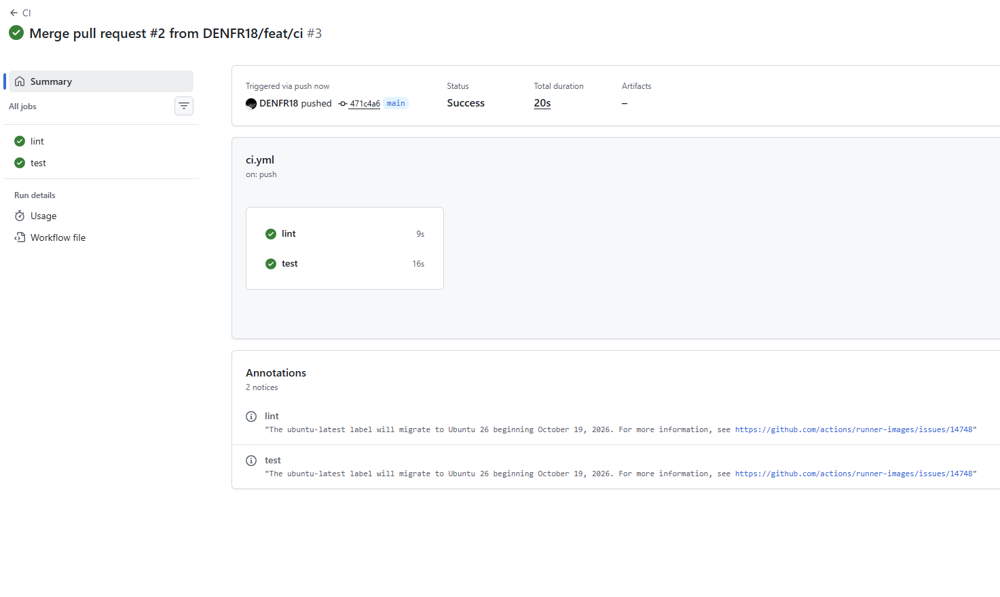
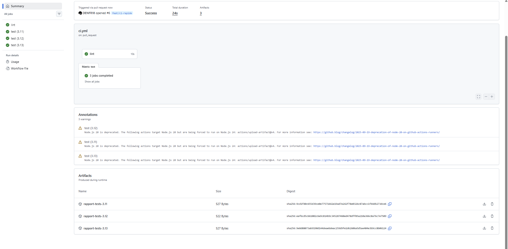
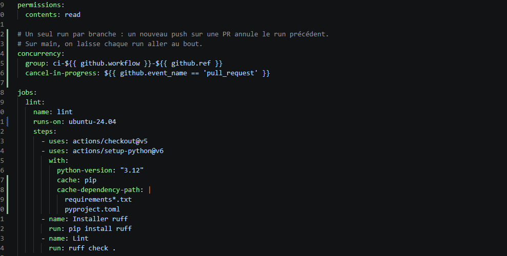
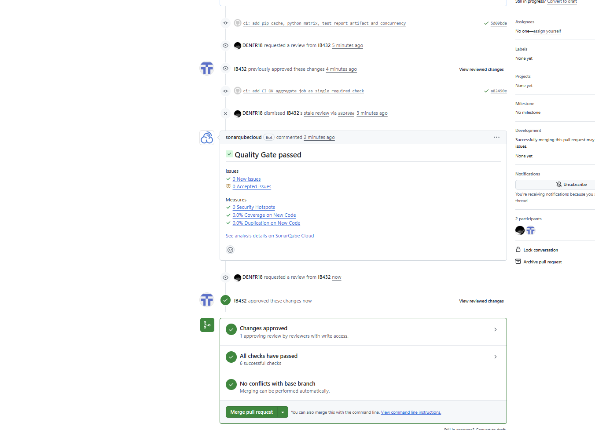
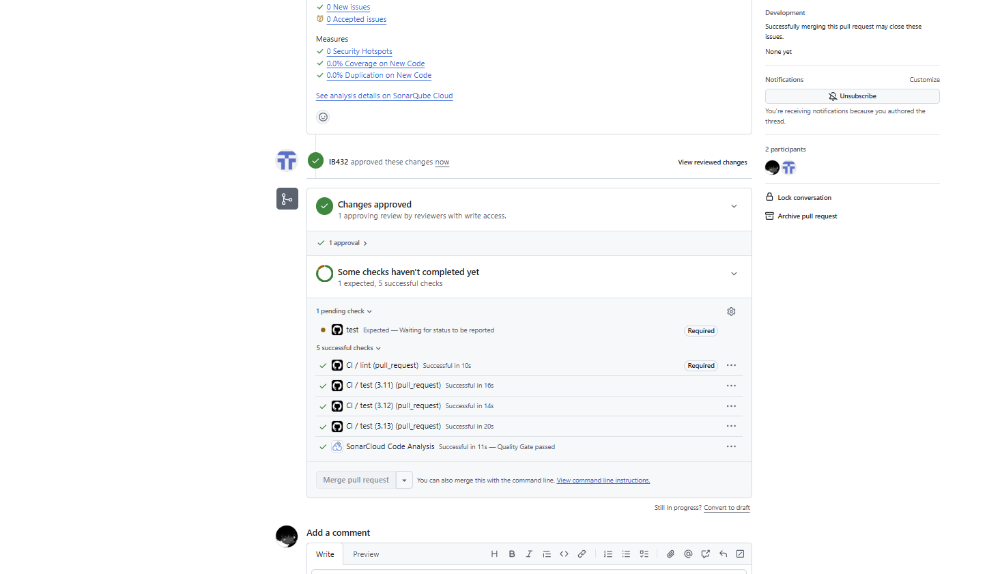
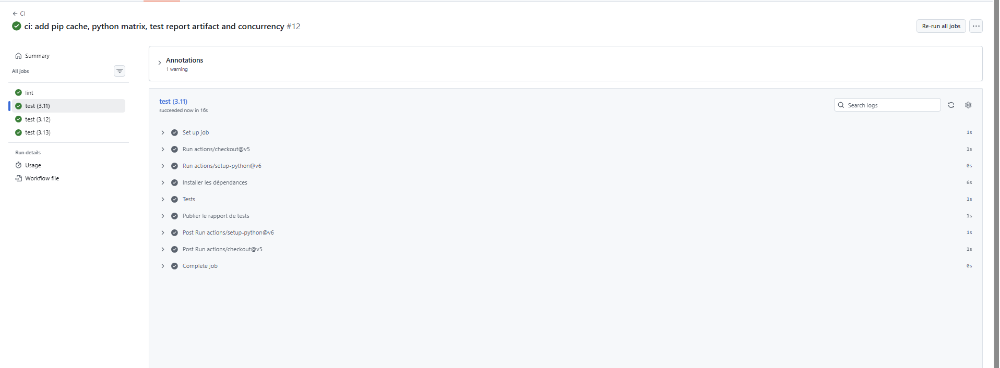
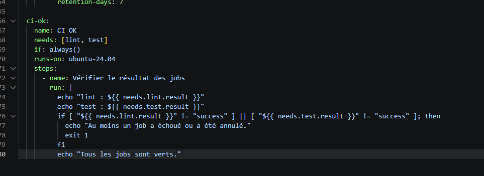
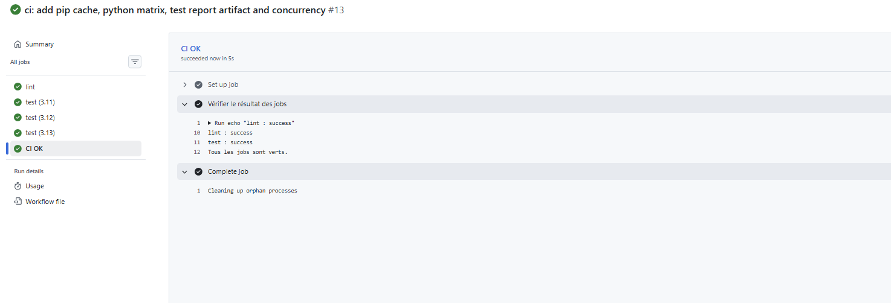
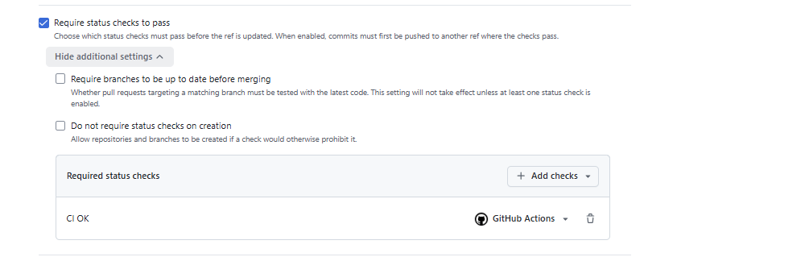

# cicd-fil-rouge — TaskFlow API

[](https://github.com/DENFR18/cicd-fil-rouge/actions/workflows/ci.yml)

API de gestion de tâches développée avec **FastAPI**, support du fil rouge CI/CD.

Fonctionnalités : création, complétion et recherche de tâches, suppression protégée par token, endpoint de santé, et injection de pannes configurable pour les exercices de fiabilité.

Ce dépôt est un fork public de [`9m7fjfpv9k-cyber/cicd-fil-rouge`](https://github.com/9m7fjfpv9k-cyber/cicd-fil-rouge).

## Équipe

| Membre | Compte GitHub | Rôle |
|---|---|---|
| Denilsson | [@DENFR18](https://github.com/DENFR18) | Propriétaire du fork, code owner |
| Illies | [@IB432](https://github.com/IB432) | Collaborateur (write), code owner |

## Structure du projet

```
.
├── .github/
│   ├── CODEOWNERS
│   └── workflows/
│       ├── ci.yml                # Lint + tests (matrice) + CI OK
│       └── publish-images.yml    # Publication des images TaskFlow
├── app/                          # Code de l'API FastAPI
├── tests/                        # Tests pytest (conftest.py + suites)
├── docs/images/                  # Captures du lab
├── Dockerfile
├── pyproject.toml
└── README.md
```

## Configuration

L'application se configure par variables d'environnement. Les trois premières sont figées au build de l'image via `ARG`.

| Variable | Défaut | Description |
|---|---|---|
| `APP_VERSION` | `dev` | Version exposée par l'API |
| `FAILURE_RATE` | `0` | Taux de requêtes en échec simulé (injection de pannes) |
| `LATENCY_MS` | `0` | Latence ajoutée à chaque requête, en millisecondes |
| `DB_PATH` | `/tmp/taskflow.db` | Chemin de la base SQLite |

## Lancer le projet

### En local

```bash
python -m pip install -e .
python -m pip install pytest httpx ruff
# À VÉRIFIER : adapter le module selon le CMD du Dockerfile
python -m uvicorn app.main:app --reload --port 8000
```

### Avec Docker

```bash
docker build -t taskflow:dev .
docker run --rm -p 8000:8000 taskflow:dev
```

Avec injection de pannes :

```bash
docker build -t taskflow:faulty --build-arg FAILURE_RATE=0.2 --build-arg LATENCY_MS=300 .
```

## Protection de la branche `main`

### Ruleset `protect-main`

| Règle | Effet |
|---|---|
| Pull request obligatoire | Aucun push direct sur `main` |
| 1 approbation requise | Une PR doit être approuvée par un collaborateur avec droits d'écriture |
| Approbations périmées annulées | Un nouveau push sur la PR annule les approbations précédentes |
| Review des code owners | Toute modification de `.github/workflows/` doit être approuvée par un code owner (voir [`.github/CODEOWNERS`](.github/CODEOWNERS)) |
| Status check requis | Le job `CI OK` doit être vert (voir [Job CI OK](#job-ci-ok)) |
| Block force pushes | Réécriture de l'historique interdite |
| Restrict deletions | Suppression de `main` interdite |

### Mise en place

1. **Fork public et binôme.** Le dépôt `9m7fjfpv9k-cyber/cicd-fil-rouge` a été forké en public, cloné en local, et IB432 a été invité comme collaborateur avec droits d'écriture.

   

2. **Ruleset sur `main`.** Création du ruleset `protect-main` ciblant la branche par défaut : PR obligatoire, 1 approbation, force push et suppression interdits.

   

3. **Push direct refusé.** Une tentative de `git push` directement sur `main` est rejetée par GitHub :

```
   remote: - Changes must be made through a pull request.
    ! [remote rejected] main -> main (push declined due to repository rule violations)
```

   

4. **Branche `feat/equipe-readme` et PR #1.** La modification passe par une PR vers `main`. Tant que le binôme n'a pas approuvé, la PR affiche « Review required » et le merge est bloqué :

   

   Une fois la PR approuvée par IB432, le merge devient possible :

   

5. **CODEOWNERS.** Le fichier `.github/CODEOWNERS` désigne DENFR18 et IB432 comme propriétaires de `.github/workflows/`, et l'option *Require review from Code Owners* est activée dans le ruleset.

### Workflow de contribution

1. Créer une branche depuis `main` à jour (`feat/...`, `fix/...`, `docs/...`).
2. Pousser la branche et ouvrir une PR **vers `main` du fork** (attention au « base repository »).
3. Attendre que `CI OK` soit vert.
4. Faire approuver par le binôme (à refaire après chaque nouveau push).
5. Merger.

## Pipeline CI

Le workflow [`.github/workflows/ci.yml`](.github/workflows/ci.yml) garantit qu'**aucun code n'arrive sur `main` sans lint ni tests**.

### Déclenchement

| Événement | Branche | Objectif |
|---|---|---|
| `pull_request` | vers `main` | Valider le code avant le merge |
| `push` | `main` | Revalider `main` après chaque merge |

Les jobs tournent sur `ubuntu-24.04`, et les permissions du workflow sont limitées à `contents: read`.

### Jobs

`lint` et les trois `test` s'exécutent **en parallèle**. `CI OK` attend leur fin.

| Job | Outil | Commande | Ce qu'il vérifie |
|---|---|---|---|
| `lint` | [ruff](https://docs.astral.sh/ruff/) | `ruff check .` | Analyse statique de tout le code Python : erreurs de syntaxe, imports inutilisés, variables non définies et règles de style (par exemple W292, retour à la ligne manquant en fin de fichier). Le job échoue dès qu'une règle est violée. |
| `test (3.11)`, `test (3.12)`, `test (3.13)` | [pytest](https://docs.pytest.org/) | `pytest -v --junitxml=...` | Exécution de la suite de 12 tests de l'API TaskFlow (santé, CRUD des tâches, recherche, token requis pour la suppression, injection de pannes) sur chaque version de Python. La configuration est lue dans `pyproject.toml`. Chaque job échoue si un seul test échoue, et publie son rapport JUnit en artefact. |
| `CI OK` | bash | — | Agrège le résultat de `lint` et de `test` : vert uniquement si tous ont réussi. C'est le seul check obligatoire du ruleset. |

Les jobs `test` installent `pytest`, `httpx` et les dépendances du projet. `httpx` est nécessaire au `TestClient` de FastAPI utilisé dans `tests/conftest.py`.

### Partie 1 : lint et tests obligatoires

1. **Activation de GitHub Actions** sur le fork, depuis l'onglet Actions. Les workflows sont désactivés par défaut sur un fork.
2. **Branche `feat/ci`** : ajout de `.github/workflows/ci.yml` avec les jobs `lint` et `test`.
3. **PR #2 vers `main`** :
   - Run #1 ❌ : `test` échouait au chargement de `tests/conftest.py` (`RuntimeError: The starlette.testclient module requires the httpx package`).
   - Correctif : ajout de `httpx` à l'installation des dépendances du job `test`.
   - Run #2 ✅ : `lint` et `test` verts, PR approuvée par le binôme puis mergée.
   - Run #3 ✅ : le workflow se relance automatiquement sur `main` après le merge (déclencheur `push`).

   

   

4. **Ruleset : status checks obligatoires.** Une fois que `lint` et `test` ont tourné au moins une fois, ils sont ajoutés comme checks requis dans `protect-main`. Ils ont ensuite été remplacés par `CI OK` en partie 2.

   

5. **Branche `fix/casse-test`** : vérification que le blocage fonctionne.

#### Démonstration : merge bloqué par un test en échec

La branche `fix/casse-test` ajoute volontairement un test faux :

```python
def test_casse():
    assert 1 + 1 == 3
```

Résultat sur la PR #3 :

- `lint` ✅ : le code respecte les règles ruff.
- `test` ❌ : `1 failed, 12 passed` (`AssertionError` sur `test_casse`).
- Le bouton **Merge pull request** est grisé : le check requis `test` est en échec.


La PR a été fermée sans être mergée.

### Partie 2 : un pipeline plus rapide, toujours aussi strict

Branche `feat/ci-rapide`, PR #6.

#### Optimisations

- **Cache pip** : `setup-python` met en cache les paquets téléchargés, avec une clé calculée sur `requirements*.txt` et `pyproject.toml`. Le cache est invalidé dès que les dépendances changent.
- **Matrice Python** : les tests tournent sur 3.11, 3.12 et 3.13. Avec `fail-fast: false`, les trois versions vont au bout même si l'une échoue.
- **Rapport de tests en artefact** : chaque version publie son rapport JUnit XML (`rapport-tests-3.11`, `-3.12`, `-3.13`, conservés 7 jours), même en cas d'échec.
- **Concurrency** : un seul run par branche. Un nouveau push sur une PR annule le run en cours ; sur `main`, chaque run va au bout.



#### Durée d'installation des dépendances (job `test (3.11)`)

| Run | Cache | Durée de l'étape « Installer les dépendances » |
|---|---|---|
| Run #12 (premier run de la branche) | Absent (*Cache not found*) | 6 s |
| Re-run | Restauré (*Cache restored*) | XX s |

Le cache pip évite le téléchargement des paquets, pas leur installation : sur un projet avec peu de dépendances, le gain se compte en secondes. Il devient plus intéressant quand les dépendances sont nombreuses ou lourdes.




#### Artefacts

Le run de la PR publie trois artefacts, un par version de Python (environ 520 octets chacun). Le rapport `junit-3.12.xml` téléchargé indique 12 tests, 0 échec et 0 erreur.




#### Job CI OK

Avec la matrice, le job `test` est publié sous les noms `test (3.11)`, `test (3.12)` et `test (3.13)`. Le ruleset attendait toujours un check nommé `test`, qui restait en *Expected — Waiting for status to be reported* : la PR était bloquée alors que tous les jobs étaient verts.



Le job `CI OK` attend la fin de `lint` et des trois `test (3.x)`, et n'est vert que si tous ont réussi : c'est le **seul check obligatoire** du ruleset, ce qui évite de modifier la protection de `main` à chaque ajout de job ou de version de Python dans la matrice. Il tourne avec `if: always()`, car sans cette condition il serait *skipped* en cas d'échec, et GitHub considère un check requis *skipped* comme validé.





Dans le ruleset, `lint` et `test` ont été remplacés par `CI OK` :



Le push du job `CI OK` a annulé l'approbation précédente d'IB432 (*dismissed stale review*). Après une nouvelle approbation et `CI OK` vert, la PR est devenue mergeable :



### Lancer les vérifications en local

```bash
python -m pip install ruff pytest httpx
python -m ruff check .
python -m pytest -v
```